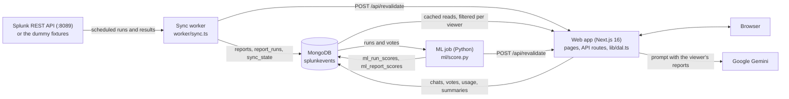
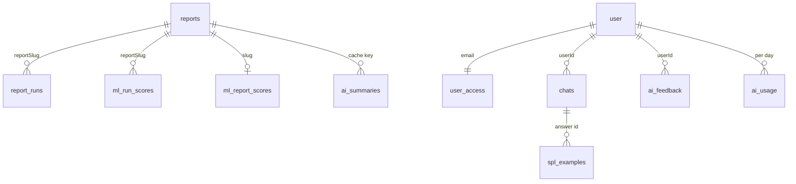
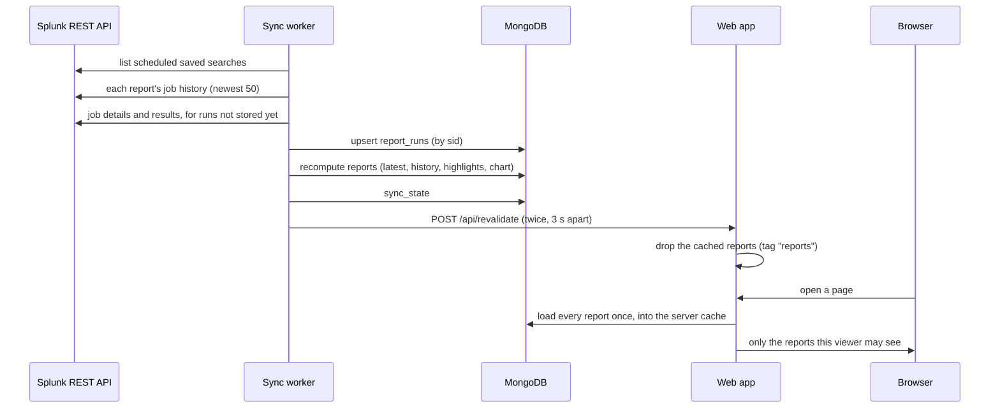
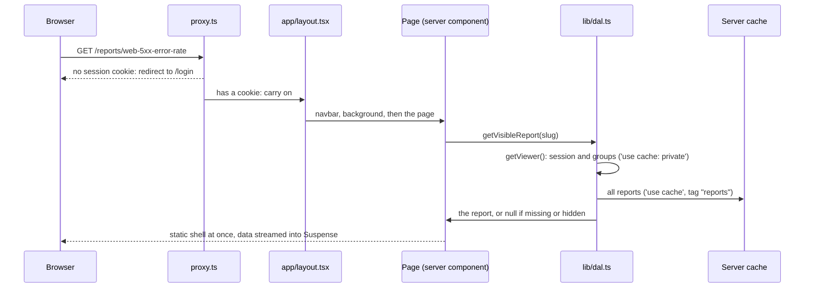
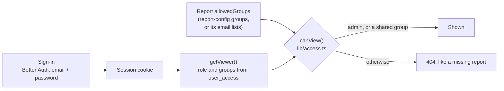
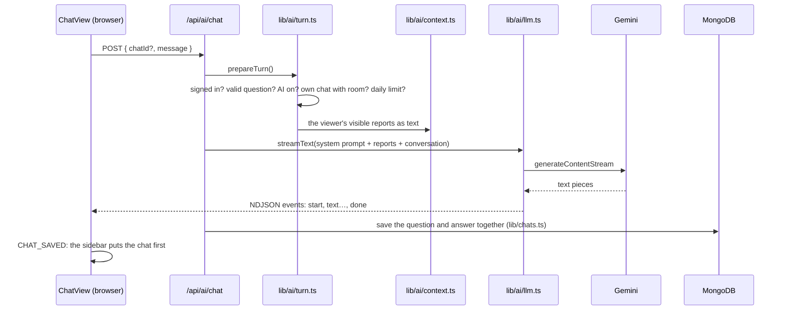

# Architecture

How SplunkEvents is put together:
- the programs, and where data lives and how it moves;
- how a page is built, and who may see what;
- how the AI and the ML job fit in;
- where it all runs.

For what each file does, see the [file reference](reference/README.md). For every setting, see [configuration.md](configuration.md).

## In one paragraph

Splunk's scheduler runs saved searches, and used to email the results.
- A separate **sync worker** copies those runs into MongoDB.
- A **Next.js web app** shows them to each team, checking access on every read.
- An optional **Python ML job** scores the runs.
- Optional **AI** (Google Gemini) answers questions about them.

The web app never talks to Splunk to read reports, and only the worker holds the Splunk token.

## The programs

| Program | Code | How it runs | Talks to | Secrets it holds |
|---|---|---|---|---|
| **Web app** | `app/`, `components/`, `lib/` | `npm run dev` or `npm start`; on Vercel; Docker's `app` service | MongoDB; Gemini (if a key is set); Splunk's parser (only with a parse-only token) | `BETTER_AUTH_SECRET`, `REVALIDATE_SECRET`, `GEMINI_API_KEY`, `SPLUNK_PARSER_TOKEN` |
| **Sync worker** | `worker/sync.ts`, `lib/splunk/` | `npm run sync` (once) or `npm run sync:watch`; Docker's `setup` service runs it once | Splunk's REST API (live) or the fixtures; MongoDB; the web app's `/api/revalidate` | `SPLUNK_TOKEN`, `REVALIDATE_SECRET` |
| **Seed script** | `scripts/seed-demo-users.ts` | `npm run seed`, safe to repeat | MongoDB | `DEMO_PASSWORD`, `BETTER_AUTH_SECRET` |
| **ML job** | `ml/` | `npm run ml`; Docker's `ml` profile | MongoDB; the web app's `/api/revalidate` | `REVALIDATE_SECRET` |
| **Write SPL eval** | `scripts/eval-spl.ts` | `npm run eval:spl` | Gemini; no database | `GEMINI_API_KEY` |

Three design choices hold this together:
- **MongoDB is the hand-off.** The programs never call each other, except the "refresh your cache" ping to `/api/revalidate`. So each one can be written in its own language (TypeScript, Python), and deployed and restarted on its own.
- **The worker only reads what Splunk's scheduler already ran.** It never starts a search, so it doesn't compete for the scheduler's concurrency limit.
- **One gate for report data.** Every page and API route reads reports through `lib/dal.ts`, which checks who is asking.

## Where data lives

One MongoDB database, `splunkevents`. Each collection has one writer.

| Collection | Written by | Holds | Kept |
|---|---|---|---|
| `reports` | sync worker | One document per scheduled report: its Splunk facts, `allowedGroups`, chart, highlights, latest run, last 7 runs | Kept; marked `disabled` once Splunk no longer schedules it |
| `report_runs` | sync worker | One document per run (by `sid`), with its result rows (up to `SYNC_MAX_ROWS`) | `RUN_RETENTION_DAYS` (TTL index) |
| `sync_state` | sync worker | When the last sync finished, and its mode | One document |
| `user`, `session`, `account`, `verification` | Better Auth | Sign-in accounts and sessions | Better Auth's rules |
| `user_access` | seed script (later: sign-in from SSO) | Each person's `role` (admin or viewer) and `groups` | Until changed |
| `chats` | web app | Ask AI conversations, at most 100 messages each | Until deleted; 24 h in `DEMO_MODE` |
| `ai_usage` | web app | Requests and tokens per account and site, per UTC day | 7 days |
| `ai_summaries` | web app | Explain summaries and briefings, under a cache key | 30 days |
| `ai_feedback` | web app | 👍 / 👎 on answers, summaries and briefing flags | Kept: the ML job's labels |
| `spl_examples` | web app | Write SPL answers saved with "Save as example" | Until taken back |
| `ai_embeddings` | web app | Vectors of searches for Write SPL's retrieval | 90 days |
| `ml_run_scores`, `ml_report_scores` | ML job | How unusual each run is, and the learned attention per report | Replaced on each run of the job |

The models are in `database/`, one file per collection ([reference](reference/database.md)). MongoDB enforces no schema; Mongoose checks it in code.

## How report data moves

- **Which searches are synced.** Scheduled saved searches that email their results, plus any listed in `lib/report-config.ts`. A search missing from `report-config` is still synced, but only admins can see it.
- **Only new runs.** The worker skips sids it has already stored, so running it again adds only new runs. One failing report doesn't stop the others.
- **Splunk forgets, MongoDB remembers.** Splunk deletes a run's results after `dispatch.ttl`, two schedule periods by default. The worker must run more often than that, and MongoDB keeps the history.
- **Derived fields are worked out once, in the worker.** `lib/splunk/map.ts` turns Splunk's JSON into the app's models:
  - the schedule text from the cron line;
  - the status, from the report's status rule in `report-config`;
  - the chart and the headline numbers.
  The web app reads finished documents and computes nothing heavy per request.
- **Two refreshes.** The second ping, 3 s after the first, catches a page that read the database just before the new data landed.

## How a page is built

- **Next.js 16 with Cache Components.** Each page has a static shell, prerendered at build time, and dynamic parts that stream in.
  - The dynamic parts sit in `<Suspense>`, or `<Reveal>`, which adds a short crossfade (`components/Transitions.tsx`).
  - Each one has a skeleton the same size as the content (`components/Skeletons.tsx`), so nothing jumps.
- **Server components by default.** They read data through `lib/dal.ts`. Files marked `'use client'` handle clicks, typing, charts and streaming.
- **`proxy.ts` is not the security check.** It only redirects visitors without a session cookie. `lib/dal.ts` checks the session and the access on every read.
- **Hidden looks missing.** A report someone may not see gets the same 404 and "Report not found" as one that doesn't exist, so its name doesn't leak.
- **Errors** land on `app/error.tsx` (a page failed, usually because the database didn't answer within 5 s), `app/global-error.tsx` (the layout failed), or a not-found page.

### Caching layers

| Layer | What | Where | How long | Cleared by |
|---|---|---|---|---|
| Report data | Every report, results, run counts, last sync time, for all viewers | Server memory (`'use cache'` in `lib/dal.ts`, tag `reports`) | Up to a minute (`cacheLife('minutes')`), then refreshed in the background on the next visit | Every sync and ML run, through `/api/revalidate` |
| The viewer | Session and groups | That person's browser only (`'use cache: private'`) | 5 minutes | Signing in or out (full page load) |
| Prefetched pages | Page shells, and a report's content when you point at its card | Browser router cache | 5 minutes | Navigation, refresh |
| Visited pages | The last 3 routes, kept hidden with their state (React Activity) | Browser | While the tab is open | Eviction, reload |
| Open pages | Re-rendered from the server cache | Browser | Every 60 s (`components/AutoRefresh.tsx`), except Ask AI pages | — |

Chats, votes and usage are never cached. Their reads start with `await connection()`, so they run per request. More detail: [caching-and-loading.md](caching-and-loading.md).

## Who sees what

- **Sign-in** is Better Auth with email and password (`lib/auth.ts`, `lib/auth-options.ts`). Sign-up is off; accounts come from `npm run seed`. `/api/auth` serves only sign-in, sign-out and session lookups.
- **Access is kept apart from sign-in.** `user_access` holds each person's role and groups by email. Moving to company SSO changes how that collection is filled, not the access code.
- **One rule.** `canView()` in `lib/access.ts`: admins see everything. Anyone else sees a report when one of their groups is in its `allowedGroups`.
- **`allowedGroups`** come from the report's `groups` in `lib/report-config.ts`, or else from its email recipients (`secops@example.com` → `secops`). See [report-access.md](report-access.md).
- **Everything per person is scoped to them.** Chats (`lib/chats.ts`), votes (`lib/feedback.ts`) and saved examples (`lib/spl-examples.ts`) are scoped the same way. For anyone else, a chat doesn't exist.
- **The AI sees only what the viewer sees.** Its prompt is built from `lib/dal.ts`'s answer for that viewer.

## Ask AI

- **One file calls the AI.** `lib/ai/llm.ts` exposes `streamText`, `generateJson` and `embed`. To use another provider (Vertex AI, a company LLM), rewrite only this file. `AI_PROVIDER=fake` returns canned answers with no key.
- **Two modes.**
  - **Ask about reports** streams Markdown back as NDJSON (`lib/ai/stream.ts`).
  - **Write SPL** returns JSON checked against a schema (`lib/ai/spl.ts`), then parses the search without running it (`lib/ai/validate.ts`). It uses Splunk's own parser with a parse-only token, or a built-in one.
- **Retrieval for Write SPL.** The request and the example searches become vectors (`lib/ai/retrieval.ts`, `lib/spl-examples.ts`). The examples are the viewer's reports plus saved answers. The 5 closest examples go into the prompt.
- **Saving.** A question and its answer are saved together, once the answer is complete. An answer that is stopped or fails isn't saved.
- **Limits.** Per account and site-wide, per UTC day (`lib/ai/usage.ts`). Summaries and briefings are written once per data key, shared, and counted once (`lib/ai/summaries.ts`, `lib/ai/keys.ts`).
- **Safety.**
  - Report rows are marked as data in the prompt.
  - Links in answers can only point at the viewer's reports, and images aren't shown.
  - With live Splunk data, AI stays off until `AI_ALLOW_LIVE_DATA=true`.

More detail: [ai.md](ai.md).

## Statistics and the ML job

- **Plain statistics, in the app** (`lib/insights.ts`).
  - A newest run is unusual when it sits 3.5 or more robust spreads from the median of at least 4 earlier successful runs.
  - The briefing and Explain show this without any AI.
- **The ML job** (`ml/score.py`, `ml/features.py`) runs after a sync.
  1. An Isolation Forest scores every run, from 0 (typical) to 1 (most unusual), and flags the 5% that differ most.
  2. Once there are 20 "Worth flagging?" votes of both kinds, a logistic regression learns which flags deserve attention.
  3. It writes `ml_run_scores` and `ml_report_scores`, then pings `/api/revalidate`.
- **The app reads the scores with the reports** (`lib/dal.ts`, as `modelRun` and `attention`). The briefing, Explain and the AI context all use them.

More detail: [ml.md](ml.md) and [ml/README.md](../ml/README.md).

## Where it runs

| Setup | Web app | Database | Sync | Use it for |
|---|---|---|---|---|
| **Local** | `npm run dev` on :3000 | MongoDB 8 via Homebrew or Docker | `npm run sync` by hand | Day-to-day work |
| **Docker** | `docker compose up --build` (`app` service, standalone server) | `mongo:7.0` container | `setup` service, once; `ml` profile on demand | Trying it with nothing installed; sharing with a team ([docker.md](docker.md)) |
| **Hosted demo** | Vercel, `main` only (`vercel.json`) | MongoDB Atlas M0 | From a laptop against Atlas, after merges | The public demo |
| **Company** | Any Node host, or the Docker image | A hosted MongoDB with its own login | `npm run sync:watch` beside it, with the Splunk token | Real Splunk ([connecting-live-splunk.md](connecting-live-splunk.md)) |
| **Kubernetes or OpenShift** | The Helm chart (`deploy/helm/splunk-events`): a Deployment behind a Route or an Ingress | The company's MongoDB, outside the chart | The `connector` CronJob, every 15 minutes, with the token from its own Secret | A company cluster ([kubernetes.md](kubernetes.md)) |

**Later, maybe Google Cloud.** Application logs may move to Google Cloud, while security logs stay in Splunk. The sync would then read from both: [google-cloud-migration.md](google-cloud-migration.md).

**Shipping.**
- `main` on `trcpoet/splunk-report-ai` changes only through pull requests.
- The ruleset requires the CI job "Lint, test and build".
- CI also runs "ML (Python)" and "Docker".
- Vercel then deploys `main`.

See [configuration.md](configuration.md#build-deploy-and-ci).

## Security at a glance

- **Secrets.** `.env*` files stay out of git, except `.env.example`.
  - The Splunk token lives only in the worker's environment.
  - The web app's optional Splunk token can only parse searches.
- **Data access.** Every read checks the viewer (`lib/dal.ts`, `lib/chats.ts`, `lib/feedback.ts`, `lib/spl-examples.ts`). `allowedGroups` never leave the server.
- **Demo mode.** `DEMO_MODE=true` shows the shared demo password on the sign-in page. Use it only with dummy data.
- **AI.** Free-tier Gemini keys may let Google use the prompts. Use them only with dummy data. For company data, use Vertex AI or the company's own LLM ([ai.md](ai.md#privacy-and-safety)).
- **The app refresh.** `/api/revalidate` compares `REVALIDATE_SECRET` in constant time. Without the secret it answers 401.
- **After signing out.** Back and Forward reload pages the browser kept (`app/layout.tsx`), so a signed-out tab can't show the previous person's reports.
