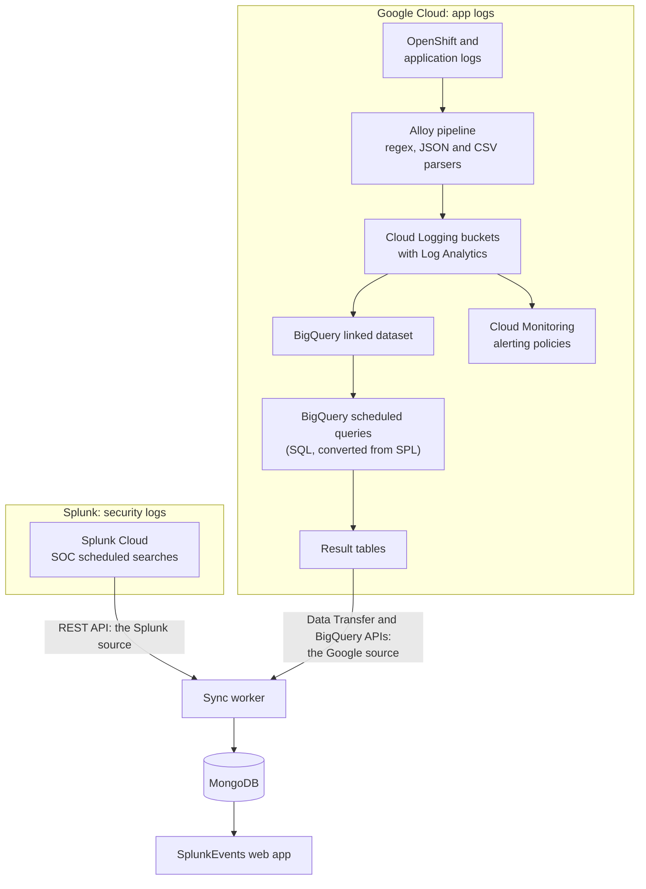

# Moving application logs to Google Cloud

How SplunkEvents would follow the company's move of application logs from Splunk to Google Cloud, while security logs stay in Splunk. It covers:
- what moves where;
- how the app reads both;
- how SPL reports become SQL;
- the phases;
- what to do until then, so today's work doesn't make the move harder.

How the app works today: [architecture.md](architecture.md). Every setting mentioned here: [configuration.md](configuration.md).

## In short

- **The end state is hybrid, for good.**
  - Security (SOC) reports keep coming from Splunk, which moves to Splunk Cloud.
  - Application reports come from Google Cloud Observability.
  - SplunkEvents becomes the one place to see both.
- **Most of the app doesn't change.** Only the sync worker reads reports from Splunk. Everything else reads MongoDB: the pages, access, the AI, the statistics, the ML job. So the move adds a second **source** to the worker, beside the Splunk one.
- **Application reports become BigQuery scheduled queries.** They're the nearest thing to Splunk's scheduled searches. Google runs them; the worker only copies their results, as it does with Splunk today.
- **A report keeps its slug, and so its history**, when its source changes. The app keeps runs in MongoDB for `RUN_RETENTION_DAYS`: 90 days by default, as long as Splunk keeps old logs. Raised well before the move ([rule 5](#until-then-rules-that-keep-todays-work-migration-safe)), it keeps the history long after Splunk's copy of the old logs has rolled off.
- **SPL becomes SQL**, report by report. A converted query must return the same columns as the old one. Then the report's status rules, highlights and charts work unchanged.
- **Timing:** the conversion is expected around late 2028. Until then, the app keeps reading Splunk, and the rules in [Until then](#until-then-rules-that-keep-todays-work-migration-safe) keep today's work cheap to move.

## What moves where



| What | Today | After the move |
|---|---|---|
| Security (SOC) logs and reports | Splunk | Splunk Cloud |
| Application logs, including OpenShift | Splunk indexes | Cloud Logging buckets, shipped by the Alloy pipeline |
| Field extraction | At search time in SPL (`rex`, `spath`, automatic key-value) | At the source, by the Alloy pipeline's regex, JSON or CSV parsers; or in the query (`REGEXP_EXTRACT`, `JSON_VALUE`) |
| Field names (the taxonomy) | Today's Splunk fields | New names, for OpenShift logging and for standalone application indexes |
| Dashboards and alerts | SPL | SQL, with Cloud Monitoring alerting policies for alerts |
| Who may read what | Splunk roles, from AD groups | Google Cloud IAM roles, from new AD groups, requested through the company's usual process |
| Old application logs | Searchable in Splunk | Kept in Splunk until they roll off, after 90 days |

## Why scheduled queries are the app's source

The worker's rule today: **the source system runs the reports, and the worker only copies their results.** It never starts a search, so it doesn't compete with anyone's searches. BigQuery scheduled queries keep that rule. They also map onto what the sync already does:

| The sync today (Splunk) | The Google source | Notes |
|---|---|---|
| List scheduled saved searches | List the scheduled queries (transfer configs in the BigQuery Data Transfer Service) | The client is `@google-cloud/bigquery-data-transfer` |
| A report's job history | `transferConfigs.runs.list` | Each run is `PENDING`, `RUNNING`, `SUCCEEDED`, `FAILED` or `CANCELLED`, much like a search job's state. Google drops runs from this history after 90 days; the app keeps its own. |
| A job's results, before `dispatch.ttl` deletes them | The rows the run added to its result table | Set up as below, nothing is lost before the worker copies it |
| `sid` | The run's name, `projects/…/transferConfigs/…/runs/<id>` | Unique, like a sid |

**Result tables.** A scheduled query either replaces its result table on each run, or appends to it. Replacing would lose a run's rows if the worker hadn't copied them yet. So:
- have each run **append** its rows, with its `@run_time` (the time it was scheduled for) as a column;
- partition the table by that column, and let partitions expire after a few days: the app keeps its own copy;
- the worker reads each new run's rows by its run time.

**Where the logs come from.**
- Log Analytics makes a Cloud Logging bucket queryable with SQL.
- A **linked dataset** lets BigQuery read that bucket without copying the logs: there's no BigQuery ingestion or storage cost, but queries are billed.
- Scheduled queries run against the linked dataset.

**Alerts.** Converted alerts belong in Cloud Monitoring. It can alert on log-based metrics, and, in preview as of 2026, on the results of a SQL query over the logs. The app's status rules are its own reading of each report, so keep the two in agreement (see [Risks](#risks)).

## Concept by concept

| Splunk | Google Cloud | In the app |
|---|---|---|
| Index, sourcetype | Log bucket (and log view), log name, resource type | The report's "Index" text |
| Scheduled saved search | Scheduled query | A report |
| Search job (`sid`) | Transfer run | A run |
| SPL | GoogleSQL | Write SPL gains a Write SQL mode |
| `rex`, `spath`, automatic fields | Parsed at the source by the Alloy pipeline, or `REGEXP_EXTRACT` and `JSON_VALUE` | A field map per report (below) |
| Email action on a report | Notification channels on an alerting policy | Access no longer comes from email lists, so set explicit `groups` |
| Splunk role, through AD | IAM roles granted to AD groups | The worker's service account needs its own roles |
| REST token for a service account | A Google service account, keyless through Workload Identity Federation where the program runs | The worker's account reads the result tables. Write SQL's dry run needs another ([Risks](#risks)). |
| Write SPL's check before a search is shown | A BigQuery **dry run**: Google validates the SQL and estimates the bytes it would read, without running it | Write SQL's check |
| "Open in Splunk" | The query opened in Log Analytics or BigQuery | Write SQL's link |

## What changes in the app

**Unchanged:**
- `lib/dal.ts` and the access rules;
- MongoDB and its collections;
- the charts, tables, briefing and Explain;
- the statistics (`lib/insights.ts`) and the ML job;
- Ask about reports, which already works from stored results whatever their source.

**Small changes in the pages.** The report page heads its query "Search query (SPL)", and offers to explain it in Write SPL. For a Google report, both should say SQL and use Write SQL. The AI's report context labels the query `SPL:` too (`lib/ai/context.ts`).

**New, in the sync worker:**
- **A source seam.** A `ReportSource` interface with two jobs: list the reports, and fetch a report's new runs with their results. Today's Splunk code (`lib/splunk/`) sits behind it, and a Google source beside it. `worker/sync.ts` runs both.
- **Each source looks after only its own reports.** Today, `syncAll` in `lib/splunk/sync.ts` marks every report that isn't scheduled in Splunk as disabled, which takes it out of the app. With two sources, that step must skip the other source's reports, or each sync would hide them.
- **Per-report settings in `lib/report-config.ts`:**
  - each entry gets a `source` (`splunk` or `google`);
  - the scheduled query's name maps to the **same slug** as the Splunk search it replaces;
  - a map from SQL column names to the names the rules and charts use;
  - a sort order, since a table doesn't keep the order of its rows.
- **Fixtures for the Google source,** as the Splunk ones exist today. They let the tests and the demo run without a Google project.

**New, in the data:**
- **Neutral field names.**
  - On `reports`, the `splunk` field becomes `source`: the source's kind, and the report's name and owner there. `spl` becomes `query`, with its language.
  - A run's `sid` becomes a run id, holding either a sid or a transfer run's name. That's in `report_runs`, and in each report's `latest`, `results` and `history`. `dispatchState` becomes a state.
- **One migration script** renames the stored fields, so nothing is lost.

**New, in Ask AI:**
- **Write SQL, beside Write SPL**, which stays for the SOC's searches. Write SQL is the same flow with a SQL prompt:
  - the BigQuery dry run as its check;
  - its examples taken from the scheduled queries;
  - the same rule that it never runs anything.
- **Vertex AI for company data.** On Google Cloud, company data would more likely go to Gemini through Vertex AI, in the company's own project. `lib/ai/llm.ts` already uses Google's SDK, which reaches Vertex AI when its client is created differently ([ai.md](ai.md#using-another-ai)).

**Optional, later:** hosting on Cloud Run (the Docker image already builds the app's standalone server), and MongoDB on Google Cloud.
- **MongoDB Atlas on Google Cloud** changes nothing in the code.
- **Firestore with MongoDB compatibility** is generally available and lists Mongoose. It doesn't support every MongoDB feature, so try the app on it first: its TTL indexes (`database/`), and the `$group` aggregation in `lib/dal.ts`.

## Translating SPL to SQL

| SPL | GoogleSQL |
|---|---|
| `index=web sourcetype=access_combined` | `FROM` the linked dataset's view, `WHERE` on the log name or resource type |
| `earliest=-24h` | `WHERE timestamp >= TIMESTAMP_SUB(CURRENT_TIMESTAMP(), INTERVAL 24 HOUR)`; in a scheduled query, `@run_time` in place of `CURRENT_TIMESTAMP()` |
| `eval x=…` | An expression in `SELECT`, with `IF()` and `CASE` |
| `where …` | `WHERE`, or `HAVING` after a grouping |
| `stats count, sum(x) by host` | `COUNT(*)`, `SUM(x)`, `COUNTIF(…)` with `GROUP BY host` |
| `timechart span=1h count` | `TIMESTAMP_TRUNC(timestamp, HOUR)` with `GROUP BY` |
| `rex field=_raw "…(?<user>…)"` | `REGEXP_EXTRACT(text_payload, r'…')`, or the Alloy pipeline's regex parser at the source |
| `spath path=a.b` | `JSON_VALUE(json_payload.a.b)` |
| `sort - x` / `head 10` | `ORDER BY x DESC` / `LIMIT 10` |
| `top 10 x` | `COUNT(*)` with `GROUP BY x`, `ORDER BY` the count, `LIMIT 10` |
| `dedup x` | `QUALIFY ROW_NUMBER() OVER (PARTITION BY x ORDER BY timestamp DESC) = 1` |
| `rename x AS "Nice name"` | A column alias, plus the report's column map in `report-config` |

**The column contract.** Each report's status rule, highlights and chart read its result columns by name.
- So a converted query must return the **same columns**, with the same meaning and units.
- SQL column names are usually snake_case, so the report's column map turns `error_rate_pct` into `Error rate %`.
- Write each report's contract down before converting it: its columns, their types, and what a row is.

**The field map.** The new taxonomy renames fields, for OpenShift logging and for standalone application indexes. So list, per report, each Splunk field it uses and its new name in Google Cloud.
- Fields that used to be extracted at search time must now be parsed by the Alloy pipeline, or extracted in the SQL.
- The field map is also what Write SQL's examples, and the AI translating a search, need most. Wrong field names are the most common reason a generated query fails.

### An example: Web Server 5xx Error Rate

Today's SPL (from the demo):

```
index=web sourcetype=access_combined
| eval is_error=if(status>=500, 1, 0)
| stats count AS requests, sum(is_error) AS errors BY host
| eval error_rate=round(errors / requests * 100, 2)
| sort - error_rate
```

The same report as a scheduled query. **This is illustrative:** the dataset, the log name and the field names depend on the real taxonomy and on how the Alloy pipeline parses access logs.

```sql
-- Every hour, appending to its result table. @run_time is the time the run
-- was scheduled for, so each run covers exactly the hour before it.
SELECT
  @run_time AS run_time,
  JSON_VALUE(json_payload.host) AS host,
  COUNT(*) AS requests,
  COUNTIF(SAFE_CAST(JSON_VALUE(json_payload.status) AS INT64) >= 500) AS errors_5xx,
  ROUND(100 * SAFE_DIVIDE(
    COUNTIF(SAFE_CAST(JSON_VALUE(json_payload.status) AS INT64) >= 500),
    COUNT(*)), 2) AS error_rate_pct
FROM `logs-project.app_logs._AllLogs`  -- the linked dataset's view
WHERE timestamp >= TIMESTAMP_SUB(@run_time, INTERVAL 60 MINUTE)
  AND timestamp < @run_time
  AND log_name LIKE '%/logs/web-access'
GROUP BY host
```

Its column map in `report-config`:

| SQL column | Report column |
|---|---|
| `host` | `Host` |
| `requests` | `Requests` |
| `errors_5xx` | `5xx errors` |
| `error_rate_pct` | `Error rate %` |
| `run_time` | Not shown. The worker uses it to find the run's rows. |

There's no `ORDER BY`, because a table doesn't keep the order of its rows. The report's sort order goes in its settings (here `Error rate %`, highest first), and the worker sorts as it copies.

With that map, the report's status rule ("a host above the 2% error budget"), its highlights and its threshold chart work as they are.

**Checking a conversion:**
1. **Dry run.** Google checks that the SQL parses, and says how many bytes it would read.
2. **Run it once, by hand,** and compare it with the Splunk report for the same hour.
3. **Parallel run** (below), for some weeks.

## Phases

| When | The company | The app |
|---|---|---|
| **Now to the move (about late 2028)** | Splunk as today | Keep improving the data and the charts on Splunk, following the rules below |
| **About 6 months before** | Logs start reaching Cloud Logging with the new taxonomy. Roles are granted. | Build the source seam and the Google source, on fixtures first, then on a development project. Rename the stored fields. Ask early for the service accounts and their roles (the worker's, and Write SQL's), because new roles take time. |
| **Parallel run, per application** | Logs go to both Splunk and Google Cloud for a while | For each report, set up its scheduled query and sync it as a **trial copy**: its own entry in `report-config`, with its own slug (for example `<slug>-google`) and only its owners in `groups`. Two sources under one slug would mix their runs in one history. Compare the copy with the Splunk report for a few weeks: the columns, the row counts and the values. |
| **Switch, report by report** | Splunk stops receiving that application's logs | Point the report's slug at its scheduled query, with `source: 'google'`, and remove the trial copy. The report's page, history, rules and charts carry on. |
| **After** | Splunk Cloud keeps the SOC's logs; old application logs roll off after 90 days | Two sources for good: the SOC's reports from Splunk, application reports from Google Cloud. The app's MongoDB history spans the switch. |

## Until then: rules that keep today's work migration-safe

These cost little now and save work at the move:

1. **Give every report explicit `groups`** in `lib/report-config.ts`. Today, a report without them falls back to its email lists, and scheduled queries have none ([report-access.md](report-access.md)).
2. **Key status rules, highlights and charts on output column names,** as they are today, and keep each report's column contract written down.
3. **Set the chart type in `report-config`** rather than relying on the chart saved in Splunk, which a scheduled query doesn't have.
4. **Keep Splunk-specific code in `lib/splunk/`** and the worker. The pages should never need to know where a report came from.
5. **Raise `RUN_RETENTION_DAYS`** well before the move, to more than a year. Then each report's trend runs straight through the switch, and outlives Splunk's 90 days of old logs. MongoDB already has the TTL index with the old value, so changing the variable isn't enough. Change the index too, for example to 400 days:
   ```js
   db.runCommand({ collMod: 'report_runs', index: { keyPattern: { runAt: 1 }, expireAfterSeconds: 400 * 86400 } })
   ```
6. **Keep copying results and run statistics, not raw logs.** The same holds in Google Cloud: summarize in the scheduled query, and copy the summary.
7. **Note each report's owner, purpose and fields** as you work on it. That's the inventory the conversion starts from.

## Risks

| Risk | How to handle it |
|---|---|
| The new taxonomy renames or drops a field a report needs | Keep the field map, and check each report in the parallel run |
| A field that SPL extracted at search time isn't parsed at the source | Add it to the Alloy pipeline, or extract it in the SQL. The parallel run shows which ones are missing. |
| **Query cost:** BigQuery bills the bytes a query reads | Filter on `timestamp`, so a query reads only the hours it needs. Read the dry run's estimate, and ask for a daily query quota on the project that runs the scheduled queries. |
| Freshness | Match each scheduled query's interval to the old search's schedule, and sync at least as often |
| Alerts and the app disagree | Use the same limits in the Cloud Monitoring policy and in the report's status rule |
| Too much access | Give the worker's service account only what it needs: listing the scheduled queries and their runs, running query jobs (BigQuery Job User), and reading the result tables (BigQuery Data Viewer on their dataset only) |
| Write SQL's dry run could read logs | Assume a dry run needs the access the query itself would: Job User, and Data Viewer on the log datasets. Give the web app its own identity, apart from the worker's, and make sure its code only ever sends dry runs. |
| No overlap to compare | Without a period when logs go to both systems, a converted report can only be compared against a different time period. Ask for a dual-shipping window per application. |

## Questions for the company

- **Ownership:** may application teams create scheduled queries, and who owns and reviews the SQL?
- **Naming:** a naming rule for scheduled queries, so each maps to a report slug.
- **Overlap:** will each application's logs go to both Splunk and Google Cloud for a few weeks?
- **Location:** the region, and the data-residency rules for logs and query results.
- **Credentials:** where the sync worker and the web app will run (on Kubernetes or OpenShift, that's the Helm chart's pods: [kubernetes.md](kubernetes.md)), and whether they can use Workload Identity Federation instead of service-account keys.
- **Roles:** which roles to request for the worker and for Write SQL, and through which AD groups.
- **AI:** is Vertex AI approved for report data, and in which project?

## References

- BigQuery: [scheduled queries](https://docs.cloud.google.com/bigquery/docs/scheduling-queries), with `@run_time` and write preferences; [a scheduled query's runs](https://docs.cloud.google.com/bigquery/docs/reference/datatransfer/rest/v1/projects.transferConfigs.runs) ([sample](https://docs.cloud.google.com/bigquery/docs/samples/bigquerydatatransfer-get-run-history)); [running queries](https://docs.cloud.google.com/bigquery/docs/running-queries), their permissions and dry runs.
- Cloud Logging: [query logs with Log Analytics](https://docs.cloud.google.com/logging/docs/analyze/query-and-view); [query a linked dataset in BigQuery](https://docs.cloud.google.com/logging/docs/analyze/query-linked-dataset); alerts [on logs](https://docs.cloud.google.com/logging/docs/alerting/monitoring-logs) and [on SQL query results](https://docs.cloud.google.com/logging/docs/analyze/sql-in-alerting) (preview).
- Firestore: [Firestore with MongoDB compatibility](https://docs.cloud.google.com/firestore/mongodb-compatibility/docs/overview) ([generally available](https://firebase.blog/posts/2025/08/firestore-mongodb-general-availability)).
- If security data ever moves too: [from SPL to YARA-L](https://docs.cloud.google.com/chronicle/docs/yara-l/transition_spl_yaral) (Google Security Operations), and [exporting its data to BigQuery](https://docs.cloud.google.com/chronicle/docs/reports/export-to-customer-managed-project).
